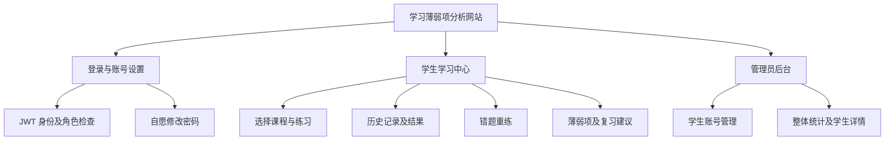
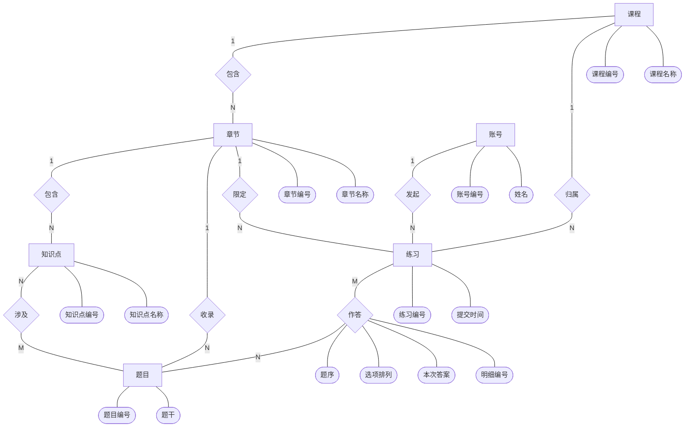

# 多课程学习薄弱项分析系统数据库设计

版本：1.2  
日期：2026年10月19日  
依据：需求文档 1.5  
阶段：数据库设计，尚未建库或编写业务代码

## 1 设计结论

采用 MySQL，共 8 张表：账号、课程、章节、知识点、题目、题目知识点关联、练习、练习明细。

课程与题库使用 SQL 脚本预置，网站不提供新增、修改、删除或停用题库的功能。每道题只存一份，不设置题目版本表或内容快照。管理员负责学生账号管理和学习数据查看。

每次练习随机抽题，单选、多选随机排列选项。练习明细保存本次排列以及作答结果，题干、选项文本和解析只保存在题目表。错题与薄弱项根据作答记录查询计算，不另建统计表。

## 2 功能模块图

## 3 实体关系

传统 Chen 概念 E-R 图见同目录的数据库ER图.png，可编辑源见数据库ER图.mmd。矩形表示实体，菱形表示联系，椭圆表示属性；1/M/N为最大基数。练习对章节的参与可选。“涉及”联系转换为 question_knowledge 表，“作答”联系及其属性转换为 practice_item 表。

一门课程包含多个章节，章节包含多个知识点和题目。一道题关联一个或多个同章节知识点，通过关联表表达多对多关系。每次练习属于一个学生和一门课程，包含多条练习明细。每条明细指向一道题。

## 4 通用约定

- 数据库建议命名 learning_analysis，表引擎 InnoDB，字符集 utf8mb4。
- 主键使用 BIGINT 自增，外键类型与主键一致；接口 ID 使用字符串，避免 JavaScript 大整数精度问题。
- 时间使用 DATETIME(3)，应用与数据库会话统一 Asia/Shanghai 时区，由后端产生。
- PK 为主键，FK 为外键，UQ 为唯一约束；未明确可空的字段均为非空。
- 外键采用 RESTRICT，阻止删除仍被引用的数据。学生账号使用停用保留历史。
- 账号使用 enabled 状态；章节使用 is_current 区分当前与旧题库，原始题目不修改。
- 不采用触发器、存储过程、题目版本、统计缓存或定时清理任务。

## 5 表结构

### 5.1 账号表 app_user

| 字段 | 类型 | 约束与含义 |
| --- | --- | --- |
| id | BIGINT | PK |
| username | VARCHAR(32) | UQ，学生为学号，管理员使用独立登录名 |
| real_name | VARCHAR(50) | 姓名 |
| password_hash | VARCHAR(255) | 加盐哈希，不对外返回 |
| role | VARCHAR(16) | STUDENT 或 ADMIN |
| enabled | TINYINT | 0 停用，1 启用，默认 1 |
| must_change_password | TINYINT | 兼容字段，默认及现有值为 0，不用于限制访问 |
| token_version | BIGINT | 默认 0，非负，用于 JWT 失效 |
| created_at | DATETIME(3) | 创建时间 |
| updated_at | DATETIME(3) | 更新时间 |

学号按字符串保存，保留前导零。管理员创建学生时角色固定为 STUDENT。默认密码 123456 仅存其哈希。首版不提供角色变更功能。

JWT 有效期 2 小时。每个请求查询账号状态及登录版本。退出、改密、重置和停用时原子执行 token_version 加一，使旧令牌全部失效；重新启用不恢复旧版本。

### 5.2 课程表 course

| 字段 | 类型 | 约束与含义 |
| --- | --- | --- |
| id | BIGINT | PK |
| name | VARCHAR(100) | UQ，课程名称 |
| description | VARCHAR(500) | 可空 |
| sort_order | INT | 非负，默认 0 |

预置高等数学、数据库系统原理、单片机、数据结构、计算机网络。

### 5.3 章节表 chapter

| 字段 | 类型 | 约束与含义 |
| --- | --- | --- |
| id | BIGINT | PK |
| course_id | BIGINT | FK → course.id |
| name | VARCHAR(100) | 与 course_id 组成 UQ |
| is_current | TINYINT | 当前题库为 1；旧章节为 0，不参与新组卷 |
| sort_order | INT | 非负，默认 0 |

### 5.4 知识点表 knowledge_point

| 字段 | 类型 | 约束与含义 |
| --- | --- | --- |
| id | BIGINT | PK |
| chapter_id | BIGINT | FK → chapter.id |
| name | VARCHAR(100) | 与 chapter_id 组成 UQ |
| description | VARCHAR(500) | 可空 |
| sort_order | INT | 非负，默认 0 |

### 5.5 题目表 question

| 字段 | 类型 | 约束与含义 |
| --- | --- | --- |
| id | BIGINT | PK |
| chapter_id | BIGINT | FK → chapter.id |
| question_type | VARCHAR(16) | SINGLE、MULTIPLE、JUDGE |
| stem | TEXT | 非空白题干 |
| option_a | VARCHAR(1000) | 原始 A 选项，非空白 |
| option_b | VARCHAR(1000) | 原始 B 选项，非空白 |
| option_c | VARCHAR(1000) | 选择题非空白，判断题为 NULL |
| option_d | VARCHAR(1000) | 选择题非空白，判断题为 NULL |
| correct_answer | VARCHAR(4) | 原始选项编码组成的标准答案 |
| explanation | TEXT | 非空白解析 |

课程通过章节关联获得，不重复保存 course_id。固定 A 至 D 是四个原子字段，不另建选项表。

单选题标准答案为 A、B、C、D 中一个。多选题至少两个正确选项，标准答案为按字母排序的集合编码：AB、AC、AD、BC、BD、CD、ABC、ABD、ACD、BCD、ABCD。

判断题 option_a 固定为“正确”，option_b 固定为“错误”，答案 A 或 B；仅界面显示中文。

示例题避免“以上都正确”“A 和 B”等依赖选项位置的文字，解析直接解释选项内容，避免随机排列后语义错误。

### 5.6 题目知识点关联表 question_knowledge

| 字段 | 类型 | 约束与含义 |
| --- | --- | --- |
| question_id | BIGINT | FK → question.id，与 knowledge_id 组成联合 PK |
| knowledge_id | BIGINT | FK → knowledge_point.id |

每道预置题至少关联一个知识点，全部属于题目章节。初始化数据校验应检查该跨表规则，普通外键本身不能保证章节一致。

### 5.7 练习表 practice

| 字段 | 类型 | 约束与含义 |
| --- | --- | --- |
| id | BIGINT | PK |
| student_id | BIGINT | FK → app_user.id，业务层限制为学生 |
| course_id | BIGINT | FK → course.id |
| chapter_id | BIGINT | 可空，FK → chapter.id；固定章节练习所属章节 |
| archived | TINYINT | 默认 0；归档记录为 1，不参与当前统计 |
| source_type | VARCHAR(16) | NORMAL、WRONG 或 CHAPTER |
| status | VARCHAR(16) | IN_PROGRESS 或 SUBMITTED |
| question_count | INT | 正整数，实际出题数 |
| correct_count | INT | 可空，提交后为 0 至 question_count |
| started_at | DATETIME(3) | 开始时间 |
| submitted_at | DATETIME(3) | 可空，提交后非空 |

每题 1 分，正确题数即得分，实际题数即满分，不另存 score 或 accuracy。进行中正确题数和提交时间均为空。未提交练习不参与统计，不要求跨设备续答。

### 5.8 练习明细表 practice_item

| 字段 | 类型 | 约束与含义 |
| --- | --- | --- |
| id | BIGINT | PK |
| practice_id | BIGINT | FK → practice.id |
| question_id | BIGINT | FK → question.id |
| order_no | INT | 正整数，与 practice_id 组成 UQ |
| option_order | VARCHAR(4) | 选择题为 ABCD 的排列；判断题固定 AB |
| selected_answer | VARCHAR(4) | 可空，学生选择的显示字母集合，按字母排序 |
| is_correct | TINYINT | 可空，提交后为 0 或 1 |

另设 UQ(practice_id, question_id)，保证同次练习不重复抽题。未作答 selected_answer 为 NULL；提交前 is_correct 为 NULL，提交后未作答计 0。

不重复保存学生、课程、题目文本或标准答案，这些通过外键获得。每次重练创建新练习，不覆盖历史答案。

## 6 选项随机排列与评分

option_order 按显示位置依次保存原始选项编码。例如 CADB 表示：

| 本次显示位置 | 对应原始选项 |
| --- | --- |
| A | C |
| B | A |
| C | D |
| D | B |

若原始单选标准答案是 A，本次显示正确答案就是 B，学生选 B 才得分。若原始多选标准答案为 AC，本次显示正确答案是 AB。

开始练习时后端随机打乱四个选项，保存 option_order，再返回按显示顺序生成的选项。随机允许保持原顺序，不要求每次一定与上次不同。页面切换或查看同次练习不重新洗牌，错题重练作为新练习重新随机。

提交时前端只传明细 ID 和所选显示字母，不传可信成绩或映射。后端读取已保存的 option_order，将显示字母转换为原始选项编码集合，再与标准答案比较。多选少选、错选、未作答均计 0。

历史及结果页按同一映射展示选项、学生答案及转换后的正确答案。进行中接口不返回标准答案、解析或原始正确编码。判断题 option_order 为 AB，不随机。

## 7 完整性与索引

数据库通过 PK、FK、UQ、NOT NULL、CHECK 保证实体完整性、参照完整性与单行业务约束。CHECK 要显式处理可空字段，不能替代 NOT NULL。

数据库应约束题型、账号角色及状态、单选唯一答案、多选 2 至 4 个答案、题型与选项空值关系、正题量、成绩范围及练习状态与提交时间的关系。选择题 option_order 必须为 ABCD 的合法排列；其与题型的匹配由后端保证。

MySQL 8.0.16 开始执行 CHECK 约束，运行数据库需满足这一能力。[官方说明](https://dev.mysql.com/blog-archive/mysql-8-0-16-introducing-check-constraint/)

后端负责账号归属、学生角色、练习课程一致性、答案合法性、明细数量与 question_count 一致、提交后禁止覆盖等跨表规则。初始化脚本验收负责题目知识点关联的数量和章节一致性。

| 表 | 索引 | 用途 |
| --- | --- | --- |
| app_user | UQ(username) | 登录及重复学号检查 |
| course | UQ(name) | 课程名称唯一 |
| chapter | UQ(course_id, name) | 同课程章节查询 |
| knowledge_point | UQ(chapter_id, name) | 章节内知识点查询 |
| question | INDEX(chapter_id, question_type) | 按章节和题型筛选 |
| question_knowledge | PK(question_id, knowledge_id) | 关联不重复 |
| question_knowledge | INDEX(knowledge_id, question_id) | 按知识点查题及统计 |
| practice | INDEX(student_id, status, submitted_at, id) | 学生历史及最近结果 |
| practice | INDEX(course_id, status, submitted_at, id) | 整体统计 |
| practice_item | UQ(practice_id, order_no) | 保留出题顺序 |
| practice_item | UQ(practice_id, question_id) | 同次题目不重复 |
| practice_item | INDEX(question_id) | 关联题目及历史查询 |

## 8 业务事务

### 8.1 开始练习

校验学生身份及课程筛选条件，从符合条件的预置题目中随机抽取。同次不重复，题量不足按实际数量出题，无题则不创建练习。

同一事务创建 practice 和所有 practice_item，保存出题顺序与选项排列。失败则整体回滚。第一版答案暂存在页面中，未提交不保存草稿。

### 8.2 提交练习

1. 校验身份与归属，锁定 practice 行。
2. 如已提交，直接返回已有结果，不重复保存或覆盖。
3. 校验请求不存在重复明细或本次之外的明细，缺少的答案按未作答处理。
4. 按数据库中的选项映射和原始标准答案评分，更新全部明细。
5. 写入正确题数、提交时间和 SUBMITTED 状态，在同一事务提交。

非法选项编码拒绝请求；多选只选一项属于有效但不完整的答案，计 0 分。两个并发提交通过行锁串行处理。

### 8.3 账号变更

密码哈希、启用状态与 token_version 的对应修改在同一事务完成。密码及 JWT 不写入日志。学生身份从令牌校验后的账号取得，不使用客户端传入的学生 ID 作为身份。

## 9 数据分析

仅使用已提交练习。累计表现统计全部作答；近期掌握情况按 student_id 与 question_id 去重，取提交时间最近的一次，不受选项排列影响。

可通过 ROW_NUMBER 窗口函数取最近作答，同一时间按 practice.id 及明细 id 降序确定顺序。[官方文档](https://dev.mysql.com/doc/refman/8.0/en/window-function-descriptions.html)

去重后再关联 question_knowledge，按知识点统计，不能在展开标签前后重复计算课程题数。

- 个人知识点不足 3 道不同题：练习不足，不评级。
- 正确率低于 60%：优先复习；60% 至不足 80%：需要巩固；80% 及以上：掌握较好。
- 课程累计正确率以全部正确作答次数除以全部作答次数，不直接平均学生百分比。
- 共性薄弱项以所有学生各题最近一次结果汇总，参与学生不足 3 人或有效学生题目组合不足 3 条时标注样本不足。
- 账号停用不删除历史，已有提交仍参与历史统计。
- 无作答知识点通过知识点列表左连接显示无记录，不计算除零结果。

例如 Q1 先错后对、Q2 对、Q3 错，累计正确率 2/4 = 50%，近期正确率 2/3 约 66.7%，为需要巩固。

错题本列出曾经出错的题目，统计历史错误次数及最近状态；之后答对标为最近已答对，不删历史。重练从相同题库创建新练习及新排列。

## 10 验收要点

| 场景 | 预期结果 |
| --- | --- |
| 重复学号或悬空外键 | 数据库拒绝 |
| 示例单选或多选不是四项 | 初始化验收失败 |
| 单选多个正确答案或多选仅一个 | 数据库约束拒绝 |
| 标准答案 A，排列 CADB，学生选显示 B | 得 1 分，历史显示正确 |
| 标准答案 AC，排列 CADB，学生选显示 AB | 得 1 分，选项顺序不影响评分 |
| 同题重新练习 | 可使用新排列，但仍按同一题统计 |
| 判断题练习 | 固定正确、错误顺序 |
| 重复或并发提交 | 仅保留同一份结果 |
| Q1 先错后对 | 累计保留两次，近期只取最近结果 |
| 一题关联两个知识点 | 知识点各计一次，课程题数只计一次 |
| 学生访问他人练习 | 后端拒绝 |
| 退出或重置后的旧令牌 | 验证失败 |
| 访问题库维护功能 | 不存在该页面或写入接口 |

## 11 环境检查记录

2026年10月19日只读检查 PATH 中的命令：Java 25.0.1、Maven 4.0.0-rc-5、MySQL 客户端 9.6.0。尚未连接数据库服务或核实服务端版本；PATH 未发现 Nginx，不代表本机一定未安装。

依赖以参考项目 Spring Boot 4.0.5、MyBatis Starter 4.0.1 为选择起点，后续核对兼容性并锁定版本。Maven 候选版本是否沿用或采用稳定版需在构建时确定。本轮不安装组件、不连接或修改数据库。

## 12 下一阶段

根据本设计完成页面及接口设计，然后编写建表 SQL、示例数据及业务代码。当前仅完成设计与文档一致性检查，数据库约束、随机映射和统计实现仍需在开发阶段验证。

## 13 固定章节练习与本轮迁移

当前题库为五门课程、每门五章、每章二十题，共 500 题。每章两个知识点，每个知识点 10 题。固定练习直接以当前章节的全体题目为定义，不增加试卷模板表，仍为八张表；每次开始创建独立 practice 和二十条 practice_item，source_type 为 CHAPTER，chapter_id 指向该章，题目按 ID 顺序出题。自主随机练习仍使用 NORMAL。

chapter.is_current 控制课程目录和新抽题范围。旧题目、章节和关联全部保留，供其他学生原练习引用。practice.archived 控制当前练习历史和统计范围。本轮仅将 20240001 原练习归档并生成 25 次新作答，共 500 题；未删除任何旧记录。

知识点查询包含当前知识点，以及学生已有未归档作答的旧知识点，后者带旧题库标识。其他十九名学生的原练习、明细及全部账号信息已通过迁移前后摘要校验，保持一致。

完整数据库迁移前备份保存在 .local/backups/before-chapter-bank.sql。新建数据库使用最新 01_schema.sql，并执行 02、03、04、06 数据脚本；05 是旧结构的升级记录，新建结构不重复执行该文件。
